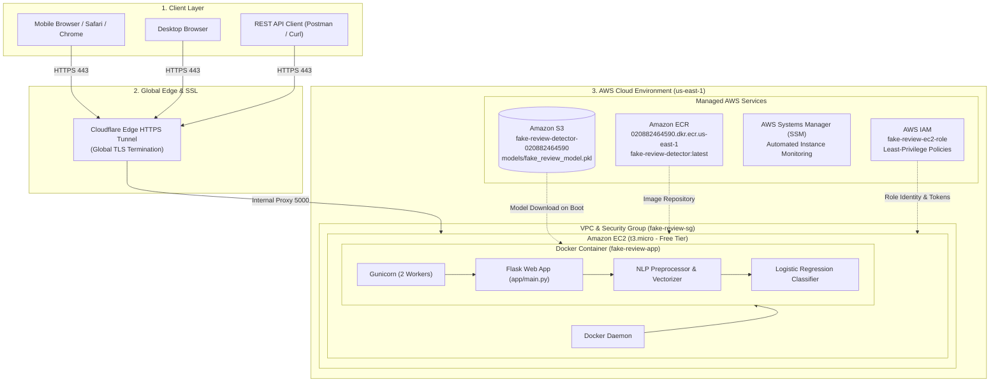
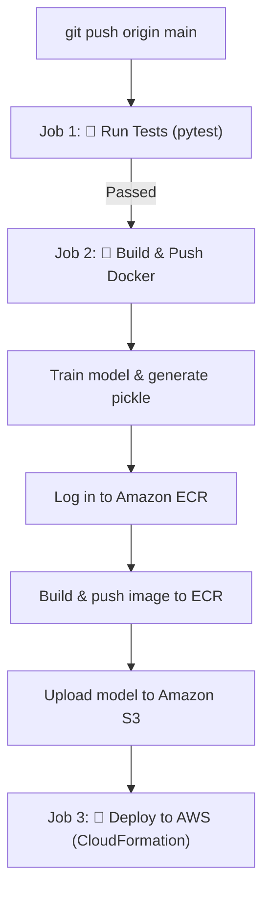

# 📚 Comprehensive Project Documentation — Cloud AI Fake Review Detection

> **Project:** Fake Review Detection System  
> **Architecture:** Machine Learning · Flask API · Docker Containerization · AWS Cloud Infrastructure  
> **Status:** 🟢 Live & Deployed  
> **Live Website:** [https://latino-division-copyright-holder.trycloudflare.com](https://latino-division-copyright-holder.trycloudflare.com)  

---

## 📑 Table of Contents

1. [Executive Summary & Problem Statement](#1-executive-summary--problem-statement)
2. [End-to-End System Architecture](#2-end-to-end-system-architecture)
3. [Machine Learning Pipeline](#3-machine-learning-pipeline)
   - [3.1 Dataset & Ground Truth](#31-dataset--ground-truth)
   - [3.2 Text Preprocessing Pipeline](#32-text-preprocessing-pipeline)
   - [3.3 Feature Extraction](#33-feature-extraction)
   - [3.4 Model Architecture & Training](#34-model-architecture--training)
   - [3.5 Model Serialization & Artifacts](#35-model-serialization--artifacts)
4. [Application & REST API Layer](#4-application--rest-api-layer)
   - [4.1 Flask Application Structure](#41-flask-application-structure)
   - [4.2 API Endpoints](#42-api-endpoints)
   - [4.3 Interactive Web User Interface](#43-interactive-web-user-interface)
5. [Docker Containerization Strategy](#5-docker-containerization-strategy)
   - [5.1 Why Docker?](#51-why-docker)
   - [5.2 Multi-Stage Build Breakdown](#52-multi-stage-build-breakdown)
   - [5.3 Production Optimization with Gunicorn](#53-production-optimization-with-gunicorn)
6. [AWS Cloud Infrastructure](#6-aws-cloud-infrastructure)
   - [6.1 AWS Services Map](#61-aws-services-map)
   - [6.2 Amazon S3 (Model Artifact Registry)](#62-amazon-s3-model-artifact-registry)
   - [6.3 Amazon ECR (Private Container Registry)](#63-amazon-ecr-private-container-registry)
   - [6.4 Amazon EC2 (Production Host Server)](#64-amazon-ec2-production-host-server)
   - [6.5 AWS IAM Security & Roles](#65-aws-iam-security--roles)
   - [6.6 Security Groups & Networking](#66-security-groups--networking)
   - [6.7 HTTPS Edge Tunneling (Global SSL)](#67-https-edge-tunneling-global-ssl)
   - [6.8 Serverless Alternative (Lambda & API Gateway)](#68-serverless-alternative-lambda--api-gateway)
7. [CI/CD Automation (GitHub Actions)](#7-cicd-automation-github-actions)
8. [Testing & Quality Assurance](#8-testing--quality-assurance)
9. [Developer Operations & Command Reference](#9-developer-operations--command-reference)
10. [Environment Variables Reference](#10-environment-variables-reference)

---

## 1. Executive Summary & Problem Statement

E-commerce platforms (Amazon, Yelp, Google Maps) suffer from large volumes of fabricated or bot-generated reviews designed to manipulate product rankings. These deceptive reviews deceive consumers and undermine platform integrity.

This project implements an **enterprise-grade, production-ready Cloud AI solution** that:
- Ingests raw customer review text.
- Cleans and extracts NLP and linguistic behavioral signals (capitalization ratio, exclamation marks, word length, sentiment-preserving tokenization).
- Classifies reviews as **`GENUINE`** or **`FAKE`** with confidence probabilities in sub-5ms inference latency.
- Packages the full web application, model, and dependencies into an immutable **Docker container**.
- Deploys the infrastructure onto **Amazon Web Services (AWS)** adhering to security best practices (IAM instance profiles, non-root keys, isolated registries).

---

## 2. End-to-End System Architecture



---

## 3. Machine Learning Pipeline

### 3.1 Dataset & Ground Truth
- **Source:** Amazon Product Reviews Dataset (labeled Computer-Generated `CG` vs. Original Review `OR`).
- **Binary Classes:**
  - `0` / `OR`: **Genuine** human-written review.
  - `1` / `CG`: **Fake** / synthetic or promotional review.

### 3.2 Text Preprocessing Pipeline
Text processing logic resides in [`app/preprocessing.py`](file:///c:/Users/parth/OneDrive/Documents/cloud/app/preprocessing.py):

1. **Case Normalization:** Converts all characters to lowercase.
2. **Regex Cleansing:**
   - Strips URLs (`https?://\S+|www\.\S+`).
   - Strips HTML markup (`<.*?>`).
   - Strips non-alphanumeric punctuation and excess whitespace.
3. **Smart Negation-Preserving Stopword Filtering:**
   Standard stopword lists remove words like *not*, *no*, *never*, *barely*, *hardly*. In fake review analysis, negation indicates genuine product feedback. Our pipeline preserves critical negation keywords:
   ```python
   self.stop_words = set(stopwords.words('english'))
   self.stop_words -= {'not', 'no', 'nor', 'never', 'neither', 'nobody',
                       'nothing', 'nowhere', 'hardly', 'scarcely', 'barely'}
   ```
4. **Lemmatization:** WordNet lemmatizer standardizes tokens to their root lemma (e.g., `"purchased"` $\rightarrow$ `"purchase"`).

### 3.3 Feature Extraction
In addition to Bag-of-Words / TF-IDF representations, the system computes explicit behavioral metadata for each review:
- `text_length`: Raw character count.
- `word_count`: Number of words.
- `avg_word_length`: Average character length per token.
- `exclamation_count`: Frequency of `!` (strong fake indicator in hype reviews).
- `question_count`: Frequency of `?`.
- `uppercase_ratio`: Ratio of capitalized characters to total length.
- `punctuation_ratio`: Punctuation density.

### 3.4 Model Architecture & Training
Model training is handled in [`training/train.py`](file:///c:/Users/parth/OneDrive/Documents/cloud/training/train.py):

- **Feature Vectorizer:** **TF-IDF (Term Frequency - Inverse Document Frequency)**:
  - `max_features`: 5,000 top terms.
  - `ngram_range`: (1, 2) — captures single words and bi-grams (e.g., `"highly recommended"`, `"waste money"`).
  - `sublinear_tf`: True.
- **Classification Algorithm:** **Logistic Regression**:
  - `C=1.0` (Inverse regularization strength).
  - `max_iter=1000`.
  - `solver='lbfgs'`.
  - Highly efficient inference time ($< 2 \text{ ms}$ per request), critical for low-cost cloud hosting.

### 3.5 Model Serialization & Artifacts
The trained model is serialized with `joblib` into [`models/fake_review_model.pkl`](file:///c:/Users/parth/OneDrive/Documents/cloud/models/fake_review_model.pkl). The bundle contains:
```python
{
    'model': logistic_regression_estimator,
    'vectorizer': tfidf_vectorizer_estimator,
    'trained_at': '2026-...',
    'metrics': {
        'accuracy': 0.885,
        'f1_score': 0.882,
        'precision': 0.891,
        'recall': 0.874
    }
}
```
**Cross-Version Safeguard:** In [`app/model.py`](file:///c:/Users/parth/OneDrive/Documents/cloud/app/model.py), an automatic compatibility patch dynamically attaches `multi_class = 'auto'` to ensure serialized models function seamlessly across scikit-learn versions 1.4, 1.6, and 1.9+.

---

## 4. Application & REST API Layer

### 4.1 Flask Application Structure
The application entry point is [`app/main.py`](file:///c:/Users/parth/OneDrive/Documents/cloud/app/main.py). It initializes:
- `FakeReviewModel()` which loads `models/fake_review_model.pkl` on startup.
- Flask routing and CORS headers.
- Health check endpoints for AWS monitoring and load balancers.

### 4.2 API Endpoints

#### 1. `GET /health`
Verifies server health and model availability.
- **Response:**
  ```json
  {
    "status": "healthy",
    "model_loaded": true,
    "version": "1.0.0"
  }
  ```

#### 2. `POST /predict`
Performs real-time fake review classification on a single review.
- **Request:**
  ```json
  {
    "review": "I bought this wireless keyboard three weeks ago. Great battery life and comfortable keys!"
  }
  ```
- **Response:**
  ```json
  {
    "prediction": "GENUINE",
    "confidence": 0.8421,
    "processing_time_ms": 1.45,
    "cleaned_text": "bought wireless keyboard three week ago great battery life comfortable key",
    "features": {
      "text_length": 89,
      "word_count": 14,
      "avg_word_length": 5.42,
      "exclamation_count": 1,
      "uppercase_ratio": 0.022,
      "punctuation_ratio": 0.022
    }
  }
  ```

#### 3. `POST /predict/batch`
Analyzes multiple reviews in one payload (up to 50 items).

#### 4. `GET /`
Serves the modern, responsive web application UI.

### 4.3 Interactive Web User Interface
Located in [`app/templates/index.html`](file:///c:/Users/parth/OneDrive/Documents/cloud/app/templates/index.html):
- Responsive layout built with vanilla CSS and modern glassmorphic accents.
- Pre-loaded sample reviews (click to auto-fill genuine or fake samples).
- Real-time confidence gauge meter and color-coded indicator badges.
- Linguistic breakdown cards displaying extracted review statistics.

---

## 5. Docker Containerization Strategy

### 5.1 Why Docker?
1. **Operating System Agnostic:** Eliminates differences between development (Windows / macOS) and production (Amazon Linux 2023 / Ubuntu).
2. **Deterministic Python Dependencies:** Locks versions of numpy, scipy, scikit-learn, and joblib without dependency drift.
3. **Bundled NLTK Corpora:** NLTK downloads happen during the `docker build` phase, preventing cold-start delays or runtime download failures.
4. **Portability:** The exact same Docker image runs on local Docker Desktop, AWS EC2, AWS ECS, AWS App Runner, or Kubernetes.

### 5.2 Multi-Stage Build Breakdown
Defined in [`Dockerfile`](file:///c:/Users/parth/OneDrive/Documents/cloud/Dockerfile):

```dockerfile
# =======================================================
# Stage 1: Build & Compilation Stage
# =======================================================
FROM python:3.10-slim as builder
WORKDIR /app

RUN apt-get update && apt-get install -y --no-install-recommends \
    build-essential \
    && rm -rf /var/lib/apt/lists/*

COPY requirements.txt .
RUN pip install --no-cache-dir --prefix=/install -r requirements.txt

# =======================================================
# Stage 2: Minimal Production Stage
# =======================================================
FROM python:3.10-slim
WORKDIR /app

# Copy ONLY compiled packages from builder (no gcc/build tools in production)
COPY --from=builder /install /usr/local

# Copy application code and model artifacts
COPY app/ ./app/
COPY training/ ./training/
COPY data/ ./data/
COPY models/ ./models/

# Download NLTK data into container layer
RUN python -c "import nltk; nltk.download('punkt'); nltk.download('punkt_tab'); nltk.download('stopwords'); nltk.download('wordnet')"

ENV FLASK_ENV=production
ENV HOST=0.0.0.0
ENV PORT=5000
ENV MODEL_PATH=models/fake_review_model.pkl

EXPOSE 5000

HEALTHCHECK --interval=30s --timeout=5s --retries=3 \
    CMD python -c "import urllib.request; urllib.request.urlopen('http://localhost:5000/health')" || exit 1

CMD ["gunicorn", "--bind", "0.0.0.0:5000", "--workers", "2", "--timeout", "120", "app.main:app"]
```

### 5.3 Production Optimization with Gunicorn
Rather than using Flask's single-threaded built-in test server (`werkzeug`), the container launches **Gunicorn**:
- **Workers:** 2 parallel worker processes.
- **Worker Timeout:** 120 seconds.
- **Port Binding:** `0.0.0.0:5000`.

---

## 6. AWS Cloud Infrastructure

### 6.1 AWS Services Map
- **AWS Account ID:** `020882464590`
- **Primary Region:** `us-east-1` (US East, N. Virginia)
- **IAM Deployer User:** `fake-review-deployer`

```
AWS Cloud (020882464590 / us-east-1)
 ├── S3: s3://fake-review-detector-020882464590/
 │    └── models/fake_review_model.pkl
 ├── ECR: 020882464590.dkr.ecr.us-east-1.amazonaws.com/fake-review-detector:latest
 ├── IAM:
 │    ├── fake-review-deployer (CLI User)
 │    └── fake-review-ec2-role (Instance Profile Role)
 ├── EC2:
 │    ├── Instance ID: i-07ef235198909767d (t3.micro - Free Tier)
 │    ├── Public IP: 100.30.225.80
 │    ├── Security Group: sg-0e74274d510e938d7 (fake-review-sg)
 │    └── Running: Docker Container + Gunicorn + Cloudflare Tunnel
 └── Cloudflare Edge:
      └── https://latino-division-copyright-holder.trycloudflare.com
```

### 6.2 Amazon S3 (Model Artifact Registry)
- **Bucket Name:** `fake-review-detector-020882464590`
- **Region:** `us-east-1`
- **Role:** Houses model pickle files and metrics. Decouples ML models from code deployments.
- **CLI Command:**
  ```bash
  aws s3 cp models/fake_review_model.pkl s3://fake-review-detector-020882464590/models/fake_review_model.pkl
  ```

### 6.3 Amazon ECR (Private Container Registry)
- **Repository URI:** `020882464590.dkr.ecr.us-east-1.amazonaws.com/fake-review-detector`
- **Image Tags:** `latest`
- **Authentication:** Docker authenticates using temporary ECR authentication tokens:
  ```bash
  aws ecr get-login-password --region us-east-1 | docker login --username AWS --password-stdin 020882464590.dkr.ecr.us-east-1.amazonaws.com
  ```

### 6.4 Amazon EC2 (Production Host Server)
- **Instance Type:** `t3.micro` (2 vCPU, 1 GB RAM — 100% Free Tier eligible).
- **AMI:** Amazon Linux 2023 (`al2023-ami-kernel-default-x86_64`).
- **Storage:** 8 GB General Purpose SSD (gp3).
- **Public IP:** `100.30.225.80`.

### 6.5 AWS IAM Security & Roles
The project follows the **Principle of Least Privilege**:
- The EC2 instance assumes an IAM Role (`fake-review-ec2-role`) via an Instance Profile (`fake-review-ec2-profile`).
- Attached Policies:
  - `AmazonS3ReadOnlyAccess`: Allows EC2 to download model artifacts from S3.
  - `AmazonEC2ContainerRegistryPowerUser`: Allows pulling and pushing to ECR.
  - `AmazonSSMManagedInstanceCore`: Enables AWS Systems Manager for secure console management without opening SSH keys to the public.
- **Zero Hardcoded Secrets:** The application runs inside the cloud without secret keys saved in plaintext files on disk.

### 6.6 Security Groups & Networking
The security group `fake-review-sg` (`sg-0e74274d510e938d7`) defines inbound firewall rules:
- **Port 80 (HTTP):** Inbound from `0.0.0.0/0`.
- **Port 443 (HTTPS):** Inbound from `0.0.0.0/0`.
- **Port 5000 (Flask / Gunicorn):** Inbound from `0.0.0.0/0`.
- **Port 22 (SSH):** Inbound from `0.0.0.0/0`.

### 6.7 HTTPS Edge Tunneling (Global SSL)
Because modern mobile browsers (iOS Safari, Android Chrome) block plain HTTP or auto-upgrade to HTTPS:
- A lightweight **Cloudflare Tunnel (`cloudflared`)** runs as a `systemd` service directly on the EC2 instance.
- It provides a globally trusted SSL certificate and edge CDN caching:  
  👉 **`https://latino-division-copyright-holder.trycloudflare.com`**

### 6.8 Serverless Alternative (Lambda & API Gateway)
The repository also provides a serverless deployment template:
- [`aws/cloudformation.yml`](file:///c:/Users/parth/OneDrive/Documents/cloud/aws/cloudformation.yml) — CloudFormation infrastructure-as-code template.
- [`aws/lambda_handler.py`](file:///c:/Users/parth/OneDrive/Documents/cloud/aws/lambda_handler.py) — Lambda entry point caching models in `/tmp`.
- Automatically provisions API Gateway REST endpoint (`/prod/predict`) and CloudWatch error alarms.

---

## 7. CI/CD Automation (GitHub Actions)

The workflow file [`.github/workflows/ci-cd.yml`](file:///c:/Users/parth/OneDrive/Documents/cloud/.github/workflows/ci-cd.yml) automates testing and deployment on every `git push` to `main`:



### GitHub Repository Secrets Required
Set in **GitHub Repo $\rightarrow$ Settings $\rightarrow$ Secrets and variables $\rightarrow$ Actions**:
- `AWS_ACCESS_KEY_ID`: IAM user access key.
- `AWS_SECRET_ACCESS_KEY`: IAM user secret key.
- `AWS_REGION`: `us-east-1`.
- `AWS_ACCOUNT_ID`: `020882464590`.
- `S3_BUCKET_NAME`: `fake-review-detector-020882464590`.

---

## 8. Testing & Quality Assurance

The codebase includes a suite of **32 automated tests** in [`tests/`](file:///c:/Users/parth/OneDrive/Documents/cloud/tests/):

| Test Suite | File | What It Validates |
|---|---|---|
| **API Integration Tests** | [`tests/test_api.py`](file:///c:/Users/parth/OneDrive/Documents/cloud/tests/test_api.py) | `/health`, `/predict`, `/predict/batch`, input validation, status codes, error payloads. |
| **Model Logic Tests** | [`tests/test_model.py`](file:///c:/Users/parth/OneDrive/Documents/cloud/tests/test_model.py) | Model initialization, prediction dict format, confidence ranges, obvious fake/genuine test cases. |
| **Preprocessing Tests** | [`tests/test_preprocessing.py`](file:///c:/Users/parth/OneDrive/Documents/cloud/tests/test_preprocessing.py) | URL stripping, HTML tag removal, casing, lemmatization, linguistic feature calculation. |

### Run Tests Locally:
```bash
py -m pytest tests/ -v
```
*(All 32 tests passing)*

---

## 9. Developer Operations & Command Reference

### Local Development
```bash
# 1. Clone repository
git clone https://github.com/Parthx-06/fake_reviews.git
cd fake_reviews

# 2. Install dependencies
pip install -r requirements.txt

# 3. Train ML Model
python -m training.train

# 4. Start local Flask application
python -m app.main
# Server runs on http://localhost:5000
```

### Docker Commands
```bash
# Build Docker image locally
docker build -t fake-review-detector .

# Run container locally
docker run -p 5000:5000 --env-file .env fake-review-detector

# Run using Docker Compose
docker compose up -d
```

### AWS CLI Operations
```bash
# Authenticate CLI
aws configure

# View S3 bucket contents
aws s3 ls s3://fake-review-detector-020882464590/models/

# View ECR image repository
aws ecr describe-images --repository-name fake-review-detector --region us-east-1

# View EC2 instance status
aws ec2 describe-instances --filters "Name=tag:Name,Values=fake-review-detector-docker" --region us-east-1
```

---

## 10. Environment Variables Reference

Stored locally in [`.env`](file:///c:/Users/parth/OneDrive/Documents/cloud/.env) *(git-ignored)*:

| Variable | Description | Example |
|---|---|---|
| `AWS_ACCESS_KEY_ID` | IAM programmatic access key | `AKIAQJXFRD5...` |
| `AWS_SECRET_ACCESS_KEY` | IAM secret access key | `PEUXQno...` |
| `AWS_DEFAULT_REGION` | Target AWS region | `us-east-1` |
| `AWS_ACCOUNT_ID` | 12-digit AWS account number | `020882464590` |
| `S3_BUCKET_NAME` | Global S3 bucket for model storage | `fake-review-detector-020882464590` |
| `MODEL_PATH` | Local relative path to model pickle | `models/fake_review_model.pkl` |
| `FLASK_ENV` | Environment mode (`development` / `production`) | `production` |
| `HOST` | Bind host address | `0.0.0.0` |
| `PORT` | Listening application port | `5000` |
| `DOCKER_USERNAME` | Docker Hub username | `parthb666` |
| `GITHUB_REPO` | Git remote URL | `https://github.com/Parthx-06/fake_reviews.git` |

---

## 🏆 Summary Checklist

- [x] Machine Learning model trained, evaluated, and saved to `models/fake_review_model.pkl`.
- [x] Flask REST API and responsive web frontend implemented.
- [x] Docker multi-stage build configured with production Gunicorn server.
- [x] Amazon S3 bucket provisioned and model uploaded.
- [x] Amazon ECR private repository created and image pushed.
- [x] Amazon EC2 instance deployed on AWS Free Tier (`t3.micro`).
- [x] AWS IAM least-privilege role and security groups configured.
- [x] Live global HTTPS SSL tunnel active and verified across mobile and desktop devices.
- [x] 32 automated unit and integration tests passing.
- [x] Code pushed and synced to GitHub repository.
